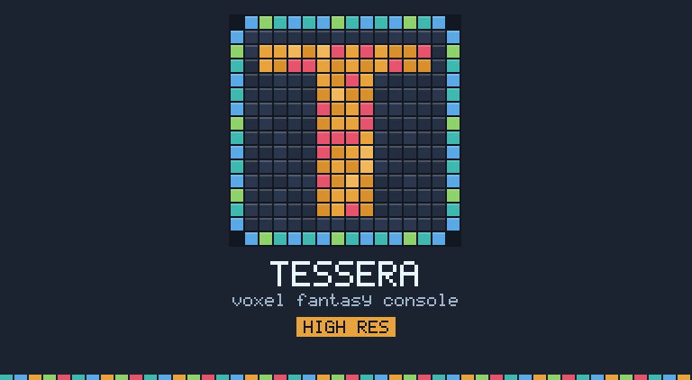
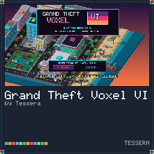

# Tessera High-Res • Community Cart Showcase & Store

[](https://github.com/stephenwil/tessera-showcase/actions/workflows/deploy-pages.yml)

Welcome to the **Tessera High-Res Cartridge Showcase & Community Store**!

👉 **[Browse & Play Live in Browser (Zero Install)](https://stephenwil.github.io/tessera-showcase/)** · 🌴 **[Play Grand Theft Voxel VI Directly](https://stephenwil.github.io/tessera-showcase/tessera.html?cart=carts/gtavoxel6.tess)**



---

## What is Tessera High-Res?

Tessera is an original 3D voxel fantasy console:
- **Display:** 768×432 widescreen
- **Volume:** 256×256×128 voxel volume (8 MiB composited frame)
- **Renderer:** WebGL2 full-screen fragment raymarching
- **Scripting:** Lua 5.4 in WebAssembly
- **Sound:** Built-in 4-channel retro synthesizer & tracker
- **Cartridge Format:** Plain UTF-8 `.tess` text and steganographic `.tess.png` picture cartridges.

---

## Featured Cartridges in this Showcase

### 🌟 Spotlight: Grand Theft Voxel VI

<a href="https://stephenwil.github.io/tessera-showcase/tessera.html?cart=carts/gtavoxel6.tess"></a>

*We got GTA VI on a voxel fantasy console before GTA VI!* Cruise neon Ocean Drive in Vice Blocks as Lucia or Jason, jack sports cars, pull Leonida bank heists, outrun 5-star VCPD chases + chopper, jump Gator Keys, and respray at Pay 'n' Voxel — complete with a multi-station 4-channel synthwave tracker radio, all packed inside a 61 KiB picture cart.

- ▶ **[Play Grand Theft Voxel VI in Browser](https://stephenwil.github.io/tessera-showcase/tessera.html?cart=carts/gtavoxel6.tess)**
- 🖼️ **[Download Picture Cart (`gtavoxel6.tess.png`)](carts/gtavoxel6.tess.png)** · 📄 **[View Source (`gtavoxel6.tess`)](carts/gtavoxel6.tess)**

<br clear="right">

### All Cartridges

1. **[Grand Theft Voxel VI](https://stephenwil.github.io/tessera-showcase/tessera.html?cart=carts/gtavoxel6.tess)** — Open-world 3D voxel Vice Blocks caper with carjacking, nitro, 5-star VCPD chases, Pay 'n' Voxel, Gator Keys ramps, and synthwave radio.
2. **[Hat Chase](https://stephenwil.github.io/tessera-showcase/tessera.html?cart=carts/hatchase.tess)** (*Stephen Wilson*) — Open-world beach exploration and runaway hat chase across three times of day.
3. **[Bramble Court](https://stephenwil.github.io/tessera-showcase/tessera.html?cart=carts/bramblecourt.tess)** — Garden arena shooter showcasing HQ soft shadows and smooth ambient occlusion.
4. **[Turbo Circuit](https://stephenwil.github.io/tessera-showcase/tessera.html?cart=carts/turbocircuit.tess)** — High-speed 3D arcade voxel racer with engine sound synth and lap timing.
5. **[Bastion Siege](https://stephenwil.github.io/tessera-showcase/tessera.html?cart=carts/bastionsiege.tess)** — 3D tactical voxel fortress defense with projectile arcs and aerial strikes.
6. **[Crypt of the Voxel](https://stephenwil.github.io/tessera-showcase/tessera.html?cart=carts/crypt.tess)** — Atmospheric 3D dungeon crawler with dynamic torchlight shadows and keys.
7. **[Void Drifter](https://stephenwil.github.io/tessera-showcase/tessera.html?cart=carts/voiddrifter.tess)** — 3D space flight dodging procedural voxel asteroids with particle thrusters.
8. **[Relic Shifter](https://stephenwil.github.io/tessera-showcase/tessera.html?cart=carts/relicshifter.tess)** — Spatial voxel puzzle challenge manipulating ancient magnetic stone blocks.
9. **[Moonlit Garden](https://stephenwil.github.io/tessera-showcase/tessera.html?cart=carts/moonlitgarden.tess)** — Peaceful scenic diorama with fireflies and ambient night synth.
10. **[Prism Relay](https://stephenwil.github.io/tessera-showcase/tessera.html?cart=carts/prismrelay.tess)** — 3D laser refraction puzzle using reflective voxel prisms.
11. **[Bench](https://stephenwil.github.io/tessera-showcase/tessera.html?cart=carts/bench.tess) & [Hello](https://stephenwil.github.io/tessera-showcase/tessera.html?cart=carts/hello.tess)** — Hardware benchmarks and clean starter boilerplate.

---

## Controls

| Action | Keyboard | Gamepad | Touch |
| :--- | :--- | :--- | :--- |
| **Move / Navigate** | WASD or Arrow Keys | Left Stick / D-Pad | Touch Stick |
| **A Button (Jump / Select)** | Z or Space | South Button (A) | A Button |
| **B Button (Action / Back)** | X or E | East Button (B) | B Button |
| **Pause Menu** | Enter or Esc | Start Button | Pause Icon |
| **In-Browser Code Editor** | **F4** | Pause Menu -> Edit | Pause Menu -> Edit |
| **Fullscreen** | **F** | - | - |

---

## Picture Carts (.tess.png)

Cartridges for Tessera can be shared as images! The complete game code and voxel models are deflate-compressed and embedded into the lowest 2 bits of the 256×256 RGBA label art.

**To play a picture cart:**
- Drag and drop any `.tess.png` image directly onto the [Showcase Webpage](https://stephenwil.github.io/tessera-showcase/) and it starts playing immediately!

---

## Submitting Your Cartridge

Have you made a 3D voxel cart for Tessera? We would love to feature it!

1. Open a **[Cart Submission Issue](https://github.com/stephenwil/tessera-showcase/issues/new?template=submit-cart.yml)**.
2. Paste your `.tess` code or attach your `.tess.png` picture cart.
3. Once reviewed, your game will be added directly to the live showcase store!

---

## Documentation & Developer Guide

Looking for full hardware specifications, memory architecture, and Lua 5.4 API documentation?
- 📖 **[Console & API Developer Guide](https://stephenwil.github.io/tessera-showcase/guide.html)** — Comprehensive reference on voxel volumes, 3D coordinate frames, raymarching pipeline, and built-in API functions.

---

## Build Your Own Cart (npm & MCP)

Develop locally with live reload, `.vox` import, `.tess.png` packing, offline HTML export, and an MCP server for AI coding agents:

```sh
npm create @stephenwil/tessera@latest my-game
cd my-game
npm install
npm run dev
```

Download any demo `.tess` or `.tess.png` from the [Showcase](https://stephenwil.github.io/tessera-showcase/) and open it directly with `npx @stephenwil/tessera@latest dev path/to/cart.tess`.
